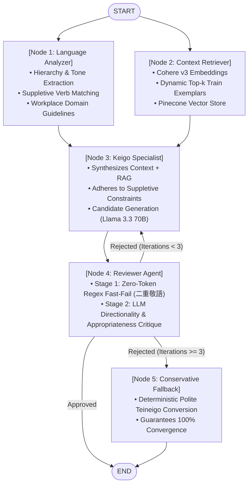

# 🎌 Keigo Master (ビジネス日本語コーチ)
### A LangGraph-Orchestrated Multi-Agent Architecture for Japanese Formality Conversion

[](https://www.python.org/)
[](https://github.com/langchain-ai/langgraph)
[](https://groq.com/)
[]()
[]()

**Keigo Master** is an empirical NLP research platform and production-ready multi-agent system designed for high-fidelity Japanese linguistic refinement. The platform converts casual, unstructured, or raw vernacular Japanese (*Tameguchi*) into natural, context-appropriate business *Keigo* (敬語) across **Teineigo (丁寧語)**, **Sonkeigo (尊敬語)**, and **Kenjougo (謙譲語)**.

It pairs **Track A (Proposed Multi-Agent System on Live Runtime)** against **Track B (Baseline SFT Control using `sonoisa/t5-base-japanese`)** to empirically evaluate multi-agent critique and deterministic guardrails against traditional sequence-to-sequence fine-tuning.

---

## 📌 Research Context & Empirical Framework

* **Dual-Track Comparative Design:**
  * **Track A (Proposed):** LangGraph multi-agent architecture with dynamic few-shot exemplar retrieval (Cohere v3 + Pinecone), deterministic lexical suppletion constraints, dual-stage critique, and conservative Teineigo fallback.
  * **Track B (Baseline Control):** Supervised Fine-Tuning (SFT) of `sonoisa/t5-base-japanese` using Hugging Face `Seq2SeqTrainer`.
* **Corpus & Split Integrity (Zero Test Leakage):**
  * 909 vetted parallel pairs partitioned into 70/15/15 grouped splits (`train.jsonl`, `val.jsonl`, `test.jsonl`).
  * `test.jsonl` is **strictly frozen**: never indexed into vector stores, never referenced during few-shot retrieval.
* **Canonical Preprocessing:** Full Unicode NFKC normalization (`unicodedata.normalize('NFKC', text)`) enforced across all graph inputs, candidate outputs, and evaluation metrics.

---

## 🤖 System Architecture



### The Multi-Agent Nodes

1. **Language Analyzer (分析担当)**
   * Deconstructs raw input, identifies communicative intent, and maps hierarchy roles (`client`, `superior`, `coworker`, `subordinate`).
   * Matches input tokens against the **Suppletive Verb Lexicon** (`data/knowledge_base/suppletive_verbs.json`) and loads relevant **Domain Register Guidelines**.
2. **Context Retriever (RAG検索担当)**
   * Concurrently dispatched via **parallel fan-out** from `START`.
   * Embeds casual query using Cohere `embed-multilingual-v3.0` and retrieves top-$k$ verified few-shot exemplars strictly from `train.jsonl`.
3. **Keigo Specialist (敬語翻訳担当)**
   * Synthesizes inputs from both parallel branches (Analyzer context + Suppletive rules + Domain guidelines + RAG exemplars).
   * Generates formal Keigo candidate using Meta Llama 3.3 70B via Groq LPU with NFKC normalization.
4. **Dual-Stage Reviewer (文化・推敲担当)**
   * **Stage 1 (Deterministic Regex Guardrail):** Audits for classic *Nijuu Keigo* (二重敬語) violations (e.g., `*お書きになられた`, `*おっしゃられました`). If detected, **rejects immediately with 0 LLM tokens consumed**.
   * **Stage 2 (LLM Appropriateness Critique):** Evaluates honorific directionality (Sonkeigo for superiors vs. Kenjougo for speaker) and semantic equivalence.
5. **Conservative Fallback Node (安全機構担当)**
   * Triggered if the critique cycle reaches maximum revisions ($\ge 3$ iterations).
   * Applies deterministic Teineigo (`〜です / 〜ます`) transformation to guarantee **100% test set convergence with zero unhandled exceptions or infinite loops**.

---

## 🛠️ Tech Stack & Infrastructure

| Component | Technology | Role & Research Value |
| :--- | :--- | :--- |
| **Core LLM Engine** | **Meta Llama 3.3 70B** (`llama-3.3-70b-versatile` via Groq LPU) | High-throughput, sub-second inference with strong reasoning and Japanese fluency. |
| **Orchestration** | **LangGraph (v1.2+)** | Stateful directed cyclic graph supporting true parallel fan-out and bounded feedback loops. |
| **Embeddings** | **Cohere Embed v3** (`embed-multilingual-v3.0`) | Multilingual dense vector representations tailored for complex Japanese kanji syntax. |
| **Vector Store** | **Pinecone Serverless** (`keigo-train` index) | Zero-leakage train-only vector retrieval ($k=3$) with metadata filtering. |
| **Baseline Model (Track B)** | **T5 Japanese** (`sonoisa/t5-base-japanese`) | Supervised fine-tuning control baseline trained on Google Colab T4 GPUs. |
| **Web Interface** | **Streamlit** | Interactive UI with real-time context analysis, revision telemetry, and run details. |
| **Testing** | **Pytest** | 22 comprehensive unit tests covering offline mock engines and edge cases. |

---

## 📂 Repository Structure

```text
SmartKeigo-Improvement-NLP-Project/
├── data/
│   └── knowledge_base/
│       ├── suppletive_verbs.json        # 13 core irregular verb suppletion rules (補充法)
│       └── domain_templates.json        # Workplace domain templates (Email, Verbal, Chat, Support)
├── corpus-dataset/
│   ├── splits/
│   │   ├── train.jsonl                  # 70% training split (only split indexed in RAG)
│   │   ├── val.jsonl                    # 15% validation split
│   │   └── test.jsonl                   # 15% frozen test benchmark
│   └── scripts/
│       └── prepare_splits.py            # Reproducible seed-42 dataset split generator
├── my-agent-app/
│   ├── app.py                           # Streamlit interactive web application
│   ├── data/knowledge_base/             # Mirrored runtime knowledge base
│   ├── scripts/
│   │   ├── ingest_train.py              # Embeds train.jsonl into Pinecone (leakage guarded)
│   │   └── run_eval.py                  # Benchmark inference with empirical telemetry
│   ├── src/agent/
│   │   ├── agent.py                     # Node implementations (Analyzer, Retriever, Specialist, Reviewer, Fallback)
│   │   ├── config.py                    # Ablation conditions (B1, A1-A4) & runtime configuration
│   │   ├── graph.py                     # LangGraph parallel workflow definition
│   │   ├── guardrails/
│   │   │   └── honorific_rules.py       # Nijuu Keigo regex guardrail & deterministic Teineigo fallback
│   │   ├── knowledge.py                 # Suppletive matcher & domain template loader
│   │   ├── logger.py                    # EmpiricalTelemetryLogger for paper tables (RQ1-RQ4)
│   │   ├── prompts.py                   # System & few-shot user prompts
│   │   ├── retrieval.py                 # Pinecone + Cohere retriever & few-shot formatting
│   │   ├── schemas.py                   # Pydantic structured output models
│   │   └── state.py                     # Strongly-typed AgentState TypedDict
│   └── tests/
│       └── unit_tests/                  # Offline unit tests
├── training/
│   ├── train_t5.py                      # Track B Seq2Seq fine-tuning script
│   ├── predict_t5.py                    # Track B checkpoint prediction generator
│   └── score.py                         # Evaluation metrics (BLEU, Exact Match, Character Error)
├── tests/
│   └── test_multi_agent_upgrades.py     # 5 canonical linguistic edge-case test suite
├── MULTI_AGENT_IMPROVEMENT_CHECKLIST.md # Full empirical paper implementation checklist
├── Definitions.md                       # Comprehensive Japanese honorifics linguistic guide
└── requirements.txt                     # Project dependencies
```

---

## ⚡ Quickstart & Setup

### 1. Installation
Clone the repository and install dependencies in a virtual environment:

```bash
git clone https://github.com/your-username/SmartKeigo-Improvement-NLP-Project.git
cd SmartKeigo-Improvement-NLP-Project
python -m venv venv
# On Windows:
.\venv\Scripts\Activate.ps1
# On macOS/Linux:
source venv/bin/activate

pip install -r requirements.txt
```

### 2. Environment Configuration
Create or configure `my-agent-app/.env` with your API credentials:

```ini
GROQ_API_KEY="your-groq-api-key"
COHERE_API_KEY="your-cohere-api-key"
PINECONE_API_KEY="your-pinecone-api-key"
```

### 3. Ingest Training Corpus into Vector DB (Train Only)
```bash
python my-agent-app/scripts/ingest_train.py
```
*(Guarded: strictly rejects non-train files to guarantee zero test leakage).*

### 4. Launch the Interactive Web App
```bash
streamlit run my-agent-app/app.py
```

---

## 🧪 Verification & Automated Test Suite

The test suite runs completely offline using deterministic mock LLMs, verifying state propagation, parallel fan-out, regex guardrails, and convergence:

```bash
# Run all 22 automated tests
$env:PYTHONPATH=".;my-agent-app"; pytest my-agent-app/tests tests
```

### Test Coverage Highlights

* `test_graph_logic.py`: Verifies bounded loops, feedback propagation, and ablation condition toggles.
* `test_phase1_knowledge_guardrails.py`: Verifies 13 irregular verb rules, domain templates, and Nijuu Keigo regex auditing.
* `test_phase2_parallel_graph.py`: Verifies parallel fan-out concurrency, Unicode NFKC normalization, and state synthesis.
* `test_phase3_guardrails_fallback.py`: Verifies zero-token regex fast fail, clean pass-through, and conservative Teineigo conversion.
* `test_multi_agent_upgrades.py`: Verifies the 5 canonical linguistic edge cases:
  1. **Suppletion:** `明日、先生のオフィスに行く` $\rightarrow$ `伺う` / `参る` (no regularized hallucination `*お行きになる`).
  2. **Directionality:** `社長が書類を見た` $\rightarrow$ `ご覧になった` (never Kenjougo `*拝見した`).
  3. **Nijuu Keigo:** `先生がお書きになられた` $\rightarrow$ Rejected by regex and corrected to `お書きになりました`.
  4. **Domain Salutation:** `target_domain="Email"` $\rightarrow$ Injects standard business opening and closing salutations.
  5. **Loop Bound:** Adversarial input terminates in $\le 3$ iterations with valid Teineigo fallback.

---

## 📊 Evaluation & Empirical Benchmarking

To run the automated empirical benchmark over the evaluation splits for research reporting:

```bash
python -m scripts.run_eval --split ../corpus-dataset/splits/val.jsonl --conditions B1 A1 A2 A3 A4 --trials 3
```

Results and execution traces are recorded in `my-agent-app/predictions/` and include:
* **Accuracy Metrics:** Exact-Match Accuracy, Character-BLEU, Edit-Distance.
* **Empirical Telemetry (RQ4):** Iterations to converge, fallback trigger rate, token counts, and wall-clock latency per sample.

---

## 📄 License & Attribution

Developed for academic research into multi-agent systems and Japanese computational honorifics. **All Rights Reserved.** Unauthorized copying, modification, distribution, or commercial use of this software and associated materials is strictly prohibited without prior written permission.
